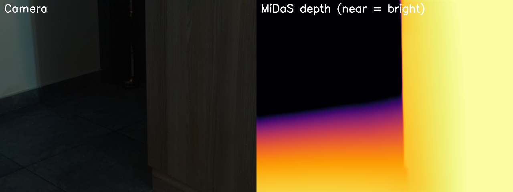
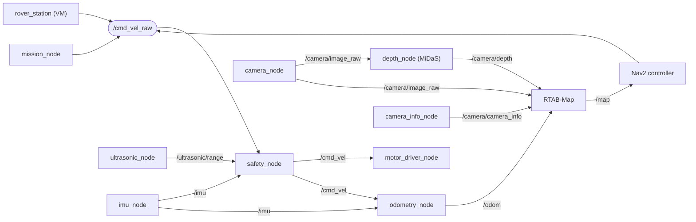
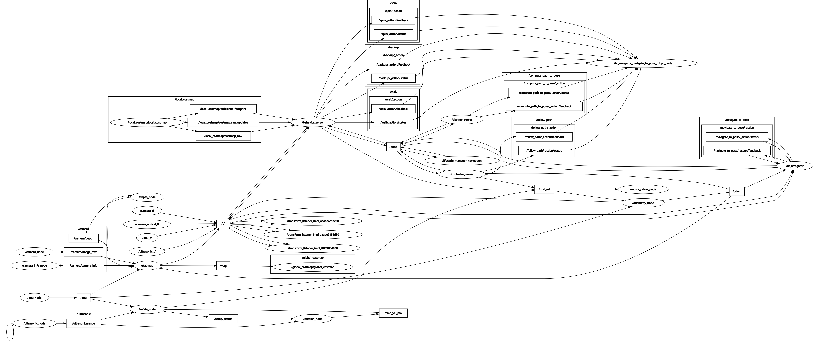
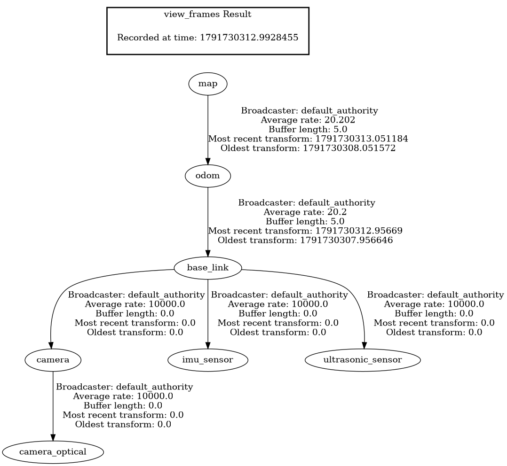
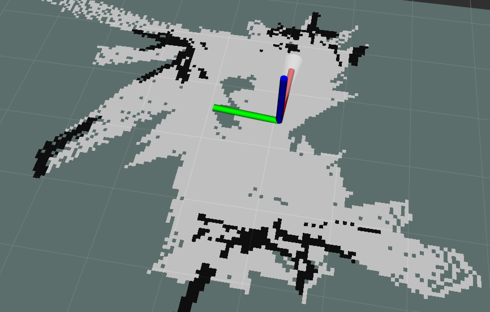
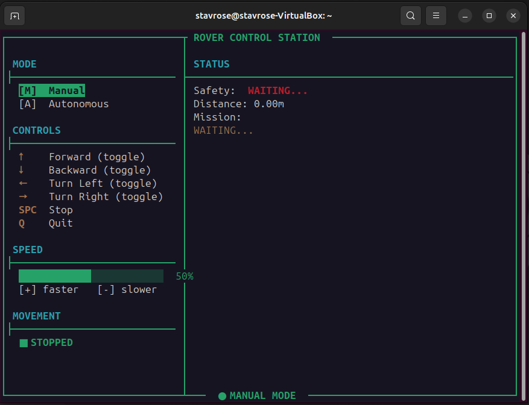

# ROS 2 Space Rover

A small 4-wheel rover, modeled on a planetary rover, that perceives depth with a **single camera and a neural network**, builds a map with **visual SLAM**, plans paths with **Nav2**, and keeps itself safe with a **reactive safety layer**. Everything runs on a Raspberry Pi 5 with ROS 2 Jazzy. There is no lidar and no stereo camera.

This was a learning project: the goal was to build each layer of a mobile robot stack myself and get them working together on real, inexpensive hardware.

<!-- Uncomment when the photo is in docs/images:

-->


*Left: what the camera sees. Right: depth estimated from that single image by MiDaS (bright = near).*

<!-- Uncomment and add the link when the demo video is uploaded:
**Demo video:** [Watch on YouTube](https://youtube.com/...)
-->

---

## Features

| Layer | What it does | How |
|---|---|---|
| **Perception** | Depth from one camera | MiDaS (small) monocular depth estimation, scaled to metres |
| **SLAM** | Map and localization | RTAB-Map with RGB + neural depth + odometry |
| **Planning** | Path planning on the map | Nav2 (planner, controller, behaviors, BT navigator) |
| **Control** | Manual and autonomous driving | Terminal control station over Wi-Fi, explore/avoid mission node |
| **Safety** | Always-on protection | Ultrasonic slow-down/stop and IMU tilt cut-off, between every command source and the motors |

---

## Architecture



Every command source (manual, autonomous, Nav2) publishes to `/cmd_vel_raw`. Only the safety node publishes to `/cmd_vel`, which drives the motors, so nothing can bypass the safety layer.



### Coordinate frames

```
map ─(RTAB-Map)─► odom ─(odometry_node)─► base_link
                                             ├── imu_sensor
                                             ├── ultrasonic_sensor
                                             └── camera  (10° down)
                                                   └── camera_optical
```



---

## Hardware

| Component | Details |
|---|---|
| Computer | Raspberry Pi 5, Ubuntu 24.04, ROS 2 Jazzy |
| Drive | 4 DC motors, 2× TB6612FNG drivers, skid steering |
| Camera | Raspberry Pi Camera v2 (IMX219), 20 cm high, tilted 10° down |
| Distance | HC-SR04 ultrasonic sensor, facing forward |
| IMU | MPU6500 over I2C (address `0x68`) |
| Control station | Ubuntu 24.04 VM (VirtualBox, bridged network) running RViz2 and the control station |

<!-- Uncomment when the photos are in docs/images:
| | |
|---|---|
|  |  |
-->

<details>
<summary>GPIO pin map (BCM)</summary>

| Signal | Pin | Purpose |
|---|---|---|
| BIN1 / BIN2 | 22 / 23 | Front-left direction |
| AIN1 / AIN2 | 17 / 27 | Front-right direction |
| BIN1_2 / BIN2_2 | 26 / 19 | Rear-left direction |
| AIN1_2 / AIN2_2 | 16 / 20 | Rear-right direction |
| STBY1 / STBY2 | 24 / 25 | Driver enable |
| PWMA | 12 | Right side speed |
| PWMB | 13 | Left side speed |
| TRIG / ECHO | 5 / 6 | Ultrasonic sensor |

</details>

---

## How it works

### Neural depth (`depth_node`)

MiDaS outputs **relative inverse depth**: larger values mean closer objects, with no units. To feed RTAB-Map, which needs metric depth, the node:

1. Downscales the frame to 256×192 (keeping the 4:3 aspect ratio) and runs MiDaS_small on the CPU (~0.65 s per frame).
2. Upscales the prediction back to exactly 640×480, because RTAB-Map rejects depth images whose size doesn't match the RGB image.
3. Converts to metres with a **fixed, calibrated scale**: `depth_m = k / midas_value`, with `k ≈ 151` measured from objects at known distances. Normalizing each frame separately made the scale jump between frames and produced an exploding, fan-shaped point cloud.
4. Clips to the reliable 0.2–1.0 m range, applies a median filter and light temporal smoothing, and publishes a `32FC1` image in metres.

### Odometry (`odometry_node`)

The rover has no wheel encoders. Linear velocity comes from the commanded speed, and angular velocity from the IMU gyro. RTAB-Map corrects the resulting drift through the `map → odom` transform.

### Safety layer (`safety_node`)

| Condition | Status | Behavior |
|---|---|---|
| Obstacle > 0.60 m | `OK` | Command passes through |
| Obstacle 0.25–0.60 m | `OBSTACLE_SLOW` | Forward speed scaled down; turning unaffected |
| Obstacle < 0.25 m | `OBSTACLE_STOP` | Forward motion blocked; reverse and turning still allowed so the rover can escape |
| Pitch or roll > 40° | `TILT_DANGER` | Full stop |

### IMU (`imu_node`)

A complementary filter (98% gyro, 2% accelerometer) estimates pitch and roll. The node retries failed I2C reads, skips any cycle with a failed axis, rejects implausible accelerometer readings, and caps the time step. Together these removed false tilt alarms caused by motor noise on the I2C bus.

<!-- Uncomment when the mapping screenshots are in docs/images:
### Mapping results

| Point cloud | Occupancy grid |
|---|---|
|  |  |
-->

---

## Performance (Raspberry Pi 5, CPU only)

| Stream | Rate |
|---|---|
| Camera (`/camera/image_raw`) | 5 Hz |
| Neural depth (`/camera/depth`) | ~0.8 Hz (MiDaS_small, ~0.65 s inference) |
| IMU (`/imu`) | 20 Hz |
| Ultrasonic (`/ultrasonic/range`) | 10 Hz |
| Safety check loop | 20 Hz |

The larger DPT_Hybrid model was tested and rejected: about 8 s per frame on the Pi.

---

## Repository layout

```
├── rover_pkg/                 ROS 2 package
│   ├── rover_pkg/             nodes (motor, ultrasonic, imu, camera, depth, odometry, safety, mission)
│   ├── launch/rover.launch.py full system: rover nodes, RTAB-Map, static TFs, Nav2
│   └── config/nav2_params.yaml
├── station/rover_station.py   terminal control station (runs on the VM)
├── tools/depth_snapshot.py    saves a camera/depth comparison image
├── system/
│   ├── cyclone_dds.xml        CycloneDDS network config
│   └── rover.service          systemd unit for auto-start on boot
└── docs/images/
```

---

## Setup

### Raspberry Pi 5

1. Install **ROS 2 Jazzy** plus these packages:
   ```bash
   sudo apt install ros-jazzy-cv-bridge ros-jazzy-rtabmap-ros ros-jazzy-rmw-cyclonedds-cpp \
     ros-jazzy-navigation2 ros-jazzy-nav2-bringup ros-jazzy-teleop-twist-keyboard i2c-tools
   ```
2. **GPIO:** `RPi.GPIO` does not work on the Pi 5. Use `gpiozero` with the `lgpio` backend:
   ```bash
   pip3 install gpiozero lgpio --break-system-packages
   sudo apt install python3-lgpio
   ```
3. **Camera:** the `libcamera` in Ubuntu's repositories is too old for the Pi 5. Build the [Raspberry Pi fork of libcamera](https://github.com/raspberrypi/libcamera) from source with the `rpi/vc4` and `rpi/pisp` pipelines and Python bindings enabled, then `pip3 install picamera2 --break-system-packages`. Add the new libraries to `LD_PRELOAD` (see `system/rover.service`).
4. **Python packages:**
   ```bash
   pip3 install "numpy<2" smbus2 torch torchvision timm --break-system-packages
   ```
   Keep NumPy below 2: `cv_bridge` is built against NumPy 1.x.
5. **Permissions:**
   ```bash
   sudo usermod -aG i2c,video $USER
   ```
6. **Build:**
   ```bash
   mkdir -p ~/rover_ws/src && cd ~/rover_ws/src
   git clone https://github.com/YOUR_USERNAME/ros2-space-rover.git .
   cd ~/rover_ws && colcon build
   ```

### Network (both machines)

Add to `~/.bashrc` on the Pi and on the control station:

```bash
export ROS_DOMAIN_ID=42
export RMW_IMPLEMENTATION=rmw_cyclonedds_cpp
export CYCLONEDDS_URI=file:///home/$USER/cyclone_dds.xml
```

Copy `system/cyclone_dds.xml` to your home folder on each machine and set the interface name (`wlan0` on the Pi, usually `enp0s3` on a VirtualBox VM). Using the interface name rather than an IP address keeps the config working when DHCP assigns a new address.

---

## Running

**On the Pi:**

```bash
ros2 launch rover_pkg rover.launch.py
```

Or enable auto-start on boot with `system/rover.service`. Don't run both at once: duplicate nodes will fight over the camera.

**On the control station:**

```bash
python3 station/rover_station.py
```

| Key | Action |
|---|---|
| ↑ ↓ ← → | Drive (press once to start, again to stop) |
| Space | Stop |
| + / - | Speed |
| M / A | Manual / autonomous mode |
| Q | Quit |

<!-- Uncomment when the screenshot is in docs/images:

-->

Open RViz2 with Fixed Frame `map` and add `/map`, `/cloud_map`, `/camera/image_raw` and `/camera/depth` to watch the rover map its surroundings.

---

## Lessons learned

- **The Pi 5 is different.** `RPi.GPIO` doesn't work, and the camera needs a newer libcamera than Ubuntu ships.
- **Frames matter.** Images must be stamped with an optical frame (`camera_optical`, z forward). Before that frame existed, the point cloud floated above the rover.
- **Neural depth needs a stable scale.** Per-frame normalization looks fine in a single image but destroys a map built over time.
- **DDS networking is fragile.** WSL2's NAT network broke discovery, so the control station moved to a bridged VirtualBox VM. CycloneDDS needed a raised participant limit once Nav2 added many nodes.
- **Hardware noise shows up in software.** Motor noise on the I2C bus caused false tilt alarms until the IMU node learned to reject bad readings.

---

## Known limitations

- **Short depth range.** Neural depth is reliable only between about 0.2 and 1.0 m, limited by the camera tilt and a calibration based on few data points.
- **Few loop closures.** At ~0.8 Hz depth with MiDaS accuracy, RTAB-Map rarely finds enough visual inliers to close loops.
- **Command arbitration.** The control station, the mission node and Nav2 all publish to `/cmd_vel_raw`. A dedicated navigation mode or `twist_mux` would stop them competing.
- **Nav2 goals from the remote station.** Goals sent from RViz2 on the VM have crashed `bt_navigator`; a DDS or package-version mismatch between the two machines is the suspected cause.
- **No command timeout.** If the control station disconnects mid-drive, the safety node keeps passing the last command through.
- **Approximate camera intrinsics.** The camera has not been formally calibrated.

## Future work

- Command timeout in the safety node and a `twist_mux` for command arbitration
- Wheel encoders for real odometry
- Camera calibration and more depth calibration points
- Persistent maps and RTAB-Map localization mode
- GPU or accelerator inference (e.g. a Hailo AI HAT) for faster, higher-quality depth

<!-- Add a license (e.g. MIT) via GitHub: Add file → Create new file → name it LICENSE → Choose a license template -->
